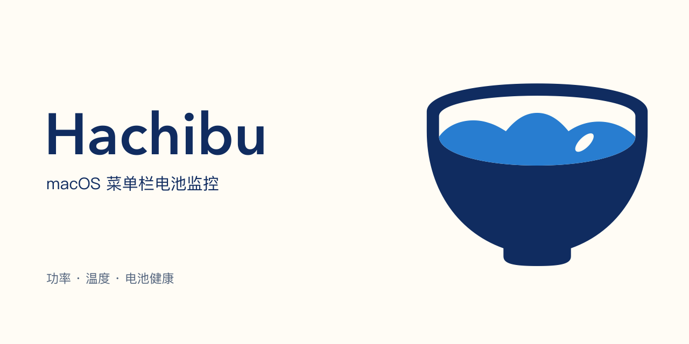
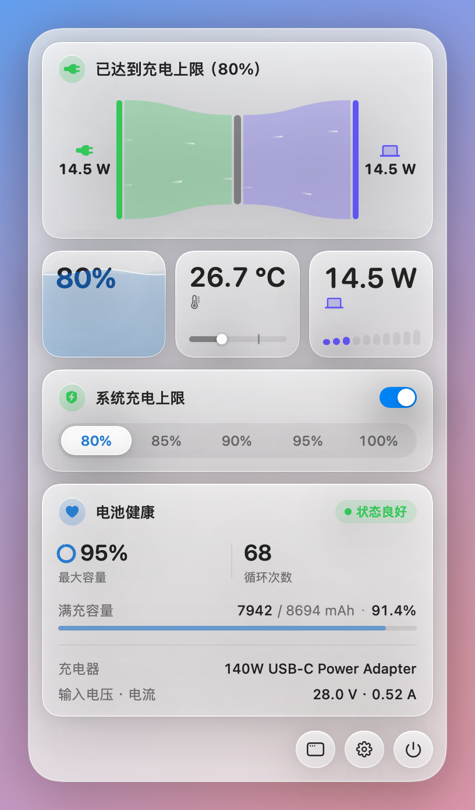
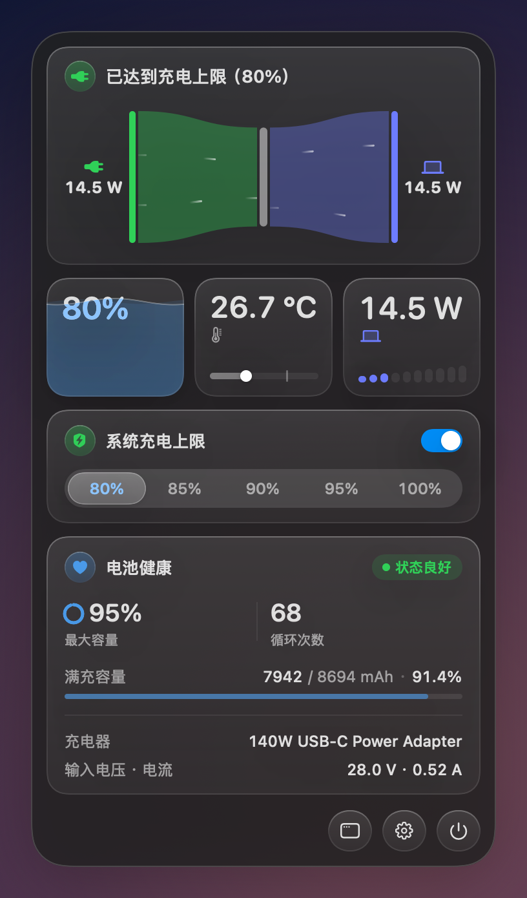
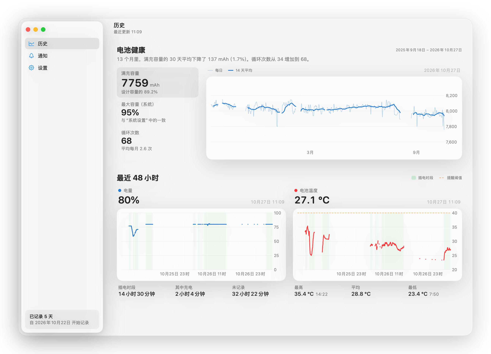
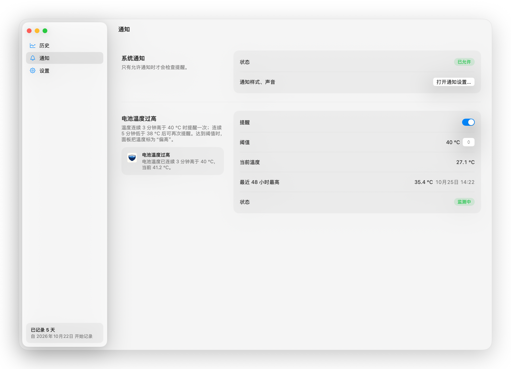
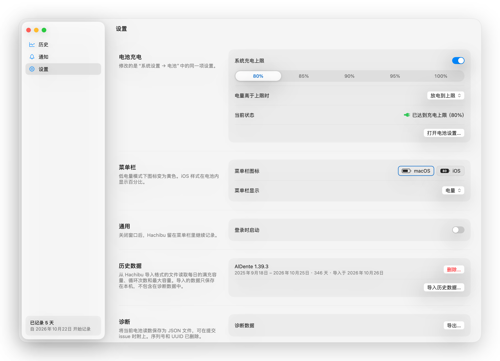

<h1 align="center">
  <picture>
    <source media="(prefers-color-scheme: dark)" srcset="docs/assets/brand/logo-dark.svg">
    
  </picture>
</h1>

<p align="center">
  <b>macOS 菜单栏电池监控与充电上限工具</b><br>
  实时显示功率流向、电量和温度，长期记录电池健康度、满充容量和循环次数，可设置系统充电上限（80%–100%）。
</p>

<p align="center">
  
  <a href="https://github.com/nanvon/hachibu/releases/latest"></a>
  <a href="https://github.com/nanvon/hachibu/releases"></a>
  <a href="https://github.com/nanvon/hachibu/actions/workflows/ci.yml"></a>
  <a href="LICENSE"></a>
</p>

<p align="center">
  <a href="https://github.com/nanvon/hachibu/releases/latest">下载</a> ·
  <a href="#功能">功能</a> ·
  <a href="#安装">安装</a> ·
  <a href="#数据与隐私">数据与隐私</a> ·
  <a href="#从源码构建">从源码构建</a> ·
  <a href="README_EN.md">English</a>
</p>



<p align="center">
  <b>腹八分目</b><br>
  <sub>hara hachi bu · 吃到八分饱就停</sub>
</p>

长期插电使用的笔记本，把电量控制在 80% 左右可以减缓电池容量衰减。Hachibu 的名字和思路都来自这句日语：它记录电池的实时读数和长期健康数据，也可以直接修改系统的充电上限。

<p align="center">
  
  
  <br>
  <sub>菜单栏面板：功率流向、电量、温度、系统充电上限和电池健康（左为浅色，右为深色）</sub>
</p>

## 功能

### 菜单栏与面板

- **菜单栏** — macOS 或 iOS 样式的电池图标，旁边可显示电量（%）、系统功率（W）或电池温度（°C）；点击打开面板。
- **充电状态** — 区分使用电池、充电中、已充满、已达到充电上限、高于充电上限、保持在当前电量、接通电源但未充电、接通电源但电量仍在下降，并显示剩余时间或充满所需时间。
- **功率流向** — 充电器、电脑、电池之间的输入功率、系统功率和电池功率。面板打开时每 2.5 秒读取一次 SMC，修改充电上限或插拔电源后改为每秒读取；读不到 SMC 时退回 IORegistry，约每 60 秒更新。
- **读数卡片** — 电量、电池温度（达到提醒阈值时标出「偏高」）、系统功率。
- **电池健康** — 系统最大容量与健康状态、循环次数、满充容量与设计容量之比；插电时显示充电器名称和输入电压、电流。
- **低电量模式** — 开启时在面板底部标出。普通应用无法切换低电量模式，这里只显示状态。

### 系统充电上限

需要 macOS 26.4 或更新版本。修改的是「系统设置 → 电池」中的同一项设置，不安装特权组件。

- **开关与档位** — 在面板或「设置 → 电池充电」开关充电上限，选择 80%–100% 的档位。
- **电量高于上限时** — 默认「放电到上限」：系统改用电池供电，放到上限后再恢复。可改为「保持当前电量」：Hachibu 把系统上限临时设为当前电量（最高 99%），由充电器供电、不再放电；拔掉电源、改回默认选项或退出 Hachibu 时，写回你设置的上限。
- **与其他工具共存** — 检测到其他充电控制应用运行时，不修改充电上限。

不支持低于 80% 的上限、在电量低于上限时暂停充电和强制放电：在较新的固件上，暂停充电所需的 SMC 接口即使用管理员权限也无法访问。

### 历史记录

在主窗口的历史页查看，鼠标悬停时显示该时刻的读数。

<p align="center">
  
  <br>
  <sub>历史页：上方是全部历史的电池健康（含从 AlDente 导入的数据），下方是最近 48 小时；曲线中断处是休眠或未运行的时段</sub>
</p>

- **电池健康** — 每天记录，显示全部历史的满充容量（每日值和 14 天平均）、系统最大容量和循环次数；记录满 60 天后，给出满充容量和循环次数的变化。
- **最近 48 小时** — 每分钟记录，显示电量和电池温度，插电时段以底色标出，温度接近提醒阈值时画出阈值线；图下列出插电、充电、未记录的时长，以及最高、平均、最低温度。
- **导入历史数据** — 在「设置 → 历史数据 → 导入历史数据…」导入 Hachibu 导入格式的 JSON 文件，补充每日的满充容量、循环次数和系统最大容量。导入的数据只存在本机。

### 后台与提醒

- **登录时启动** — 默认关闭，在「设置 → 通用」打开；后台持续记录，不阻止系统休眠。
- **温度提醒** — 电池温度连续 3 分钟高于阈值（默认 40°C）时发送通知，温度回落后可再次提醒；开关和阈值在通知页修改。
- **诊断导出** — 将电池原始读数导出为 JSON，导出前移除序列号、UUID 等设备标识。
- **界面语言** — 英文、简体中文。

<p align="center">
  
  <br>
  <sub>通知页：通知权限、温度提醒的阈值、当前温度和最近 48 小时最高温度</sub>
</p>

<p align="center">
  
  <br>
  <sub>设置页：系统充电上限、菜单栏、登录时启动和导入的历史数据</sub>
</p>

## 安装

运行环境：macOS 14 Sonoma 或更新版本，Apple Silicon（M 系列芯片），不支持 Intel Mac。修改充电上限需要 macOS 26.4 或更新版本。

1. 从 [Releases 页面](https://github.com/nanvon/hachibu/releases/latest) 下载 `Hachibu.dmg`。
2. 打开 DMG，将 `Hachibu.app` 拖入「应用程序」文件夹。

Hachibu 每天检查一次更新，有新版本时提示安装；也可以在「设置 → 关于 → 检查更新…」手动检查。

> [!NOTE]
> **首次启动被系统拦截时**
>
> 发布的构建为 ad-hoc 签名，没有经过 Apple 公证。
> 1. 打开「系统设置 → 隐私与安全性」，找到 Hachibu 的拦截提示，点击「仍要打开」；
> 2. 若提示「应用程序已损坏」，在终端执行：
>    ```bash
>    xattr -dr com.apple.quarantine /Applications/Hachibu.app
>    ```

第三方充电控制工具会改变充电行为。同时运行时，Hachibu 显示的是这些工具控制之后的实际状态，例如「已接通电源，未充电」。没有内置电池的 Mac（如 Mac mini、Mac Studio）只显示「未检测到电池」，不记录数据。

## 数据与隐私

所有数据都在本机读取和保存。Hachibu 访问的内容如下：

| 数据来源 | 访问方式 | 用途 |
| :--- | :---: | :--- |
| IOKit 电源信息（IOPowerSources） | 只读 | 电量、充电状态、剩余时间、充电器信息 |
| IORegistry 的 `AppleSmartBattery`、`AppleSmartBatteryPack` 节点 | 只读 | 电压、电流、功率、温度、容量、循环次数 |
| SMC | 只读，不含写入代码 | 充电状态、功率、输入电压电流和温度的实时读数 |
| `system_profiler SPPowerDataType` | 只读，每小时运行一次 | 系统最大容量、健康状态 |
| 私有框架 PowerUI | 读写 | 读取系统充电上限；在你操作开关或档位，或「保持当前电量」开始、结束时写入 |
| `/Library/Preferences/com.apple.powerd.charging.plist` | 只读 | PowerUI 不可用时读取系统充电上限 |
| `~/Library/Application Support/io.github.nanvon.hachibu/` | 读写 | 历史数据库 `history.sqlite` |

- **记录方式** — 分钟数据保留 7 天，之后汇总为小时数据；每日数据永久保存。休眠期间没有记录，曲线在这段时间断开。
- **不上传数据** — 不包含统计或追踪代码，不向任何服务器发送电池数据。
- **检查更新** — 每天访问一次 GitHub Releases 上的更新源，不附带设备信息。
- **未启用 App Sandbox** — 读取上表的系统文件、运行 `system_profiler` 和调用 PowerUI 需要关闭沙盒。通知权限只用于温度和健康度提醒。
- **清除数据** — 退出 Hachibu 后删除上表中的 Application Support 目录。

## 从源码构建

需要 Xcode 26 或更新版本，以及 [XcodeGen](https://github.com/yonaskolb/XcodeGen)。

```bash
brew install xcodegen
git clone https://github.com/nanvon/hachibu.git
cd hachibu
xcodegen generate
open Hachibu.xcodeproj
```

在 Xcode 中选择 `Hachibu` scheme 运行。默认使用本地签名（Sign to Run Locally），不需要 Apple 开发者账号。命令行构建：

```bash
xcodebuild -project Hachibu.xcodeproj -scheme Hachibu -configuration Debug build
```

使用自己的证书签名：将 `Config/Local.xcconfig.example` 复制为 `Config/Local.xcconfig`，填入 Team ID 和签名身份。该文件已加入 `.gitignore`。

打包 DMG 使用 `scripts/build.sh`，需要提供 Sparkle 公钥，流程见 [docs/打包发布.md](docs/打包发布.md)。

## 许可证

本项目按 [GNU 通用公共许可证第 3 版](LICENSE)发布，仅限第 3 版（GPL-3.0-only）。
