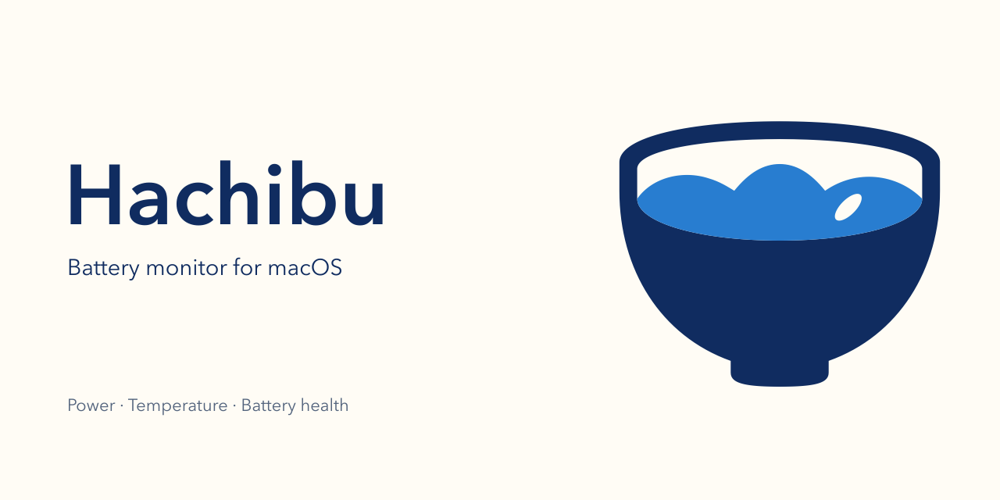

<h1 align="center">
  <picture>
    <source media="(prefers-color-scheme: dark)" srcset="docs/assets/brand/logo-dark.svg">
    
  </picture>
</h1>

<p align="center">
  <b>Battery monitor for the macOS menu bar</b><br>
  See charge, power, and temperature in the menu bar, and track long-term changes in battery health, full charge capacity, and cycle count.
</p>

<p align="center">
  
  
  
  
</p>

<p align="center">
  <a href="#-features">Features</a> ·
  <a href="#-installation">Installation</a> ·
  <a href="#-data-and-privacy">Data and Privacy</a> ·
  <a href="#-build-from-source">Build from Source</a> ·
  <a href="#-roadmap">Roadmap</a> ·
  <a href="README.md">简体中文</a>
</p>

> [!NOTE]
> Hachibu is under development and has no downloadable release yet. This page describes the features planned for v1.

The name comes from the Japanese saying *hara hachi bu* (腹八分目): stop eating when you are 80% full. For a laptop that stays plugged in most of the time, keeping the charge around 80% slows down battery capacity loss, and this project starts from the same idea. v1 handles monitoring and history; charge limit control is planned for v2.



## ✨ Features

### Menu Bar and Panel

- **Menu bar reading** — Shows battery level (%), system power (W), or battery temperature (°C), your choice. Click to open the detail panel.
- **Charging status** — Distinguishes On Battery, Charging, Fully Charged, Charge Limit Reached, Plugged In Not Charging, and Plugged In Draining, with time remaining to full or empty.
- **Power flow** — Shows input power, system power, and battery charge/discharge power across three nodes: charger, computer, and battery. Values come straight from the hardware with no derived numbers. The hardware refreshes them about every 60 seconds, and the panel shows when they were last updated.
- **Battery details** — Maximum capacity reported by macOS and health status, full charge capacity as a ratio of design capacity, cycle count and design cycle count, temperature, voltage, and current.
- **Charger info** — Charger name, manufacturer, and rated wattage while plugged in.
- **Low Power Mode** — Shows whether Low Power Mode is on.
- **System charge limit** — On macOS 26.4 and later, if a charge limit is set in System Settings, Hachibu reads it to tell whether the limit has been reached.

### History

- **Recent charts** — Battery level, system power, and temperature recorded every minute, viewable over 1 hour, 24 hours, or 7 days. Plugged-in periods are shaded.
- **Long-term charts** — Health, full charge capacity, and cycle count recorded once a day, viewable over 30 days, 1 year, or all time.
- **Retention** — Minute data is kept for 7 days and then rolled up into hourly data. Daily data is kept permanently.
- **Recorded as read** — Metrics that cannot be read show "—" instead of 0. Nothing is filled in while the Mac is asleep; charts break at the gap.

### Background and Alerts

- **Launch at login** — Keeps recording in the background without preventing the Mac from sleeping.
- **Notifications** — Alerts when battery temperature stays above a threshold for 3 minutes (40°C by default), or when maximum capacity drops below a threshold (80% by default). Both thresholds can be changed in Settings.
- **Diagnostics export** — Exports raw battery readings as a JSON file to attach to bug reports. Serial numbers, UUIDs, and other device identifiers are removed before export.
- **Languages** — English and Simplified Chinese.

## 📦 Installation

> **Requirements**: macOS 14 Sonoma or later on Apple Silicon (M-series chips). Intel Macs are not supported.

1. Download the latest `Hachibu.dmg` from the [Releases page](https://github.com/nanvon/hachibu/releases/latest).
2. Open the DMG and drag `Hachibu.app` into the Applications folder.

After that, use Settings → About → Check for Updates… to see what's new. Updates are downloaded, installed, and relaunched automatically.

> [!NOTE]
> **If macOS blocks the first launch**
>
> Release builds are ad-hoc signed and not notarized by Apple. If the first launch is blocked:
> 1. Open System Settings → Privacy & Security, scroll down to the message about Hachibu, and click "Open Anyway".
> 2. If macOS says the app is damaged, clear the quarantine flag in Terminal:
>    ```bash
>    xattr -dr com.apple.quarantine /Applications/Hachibu.app
>    ```

> [!NOTE]
> Charge control tools such as AlDente change charging behavior. When one is running, Hachibu shows the actual charging state under that tool's control, for example "Plugged In, Not Charging".

On Macs without a built-in battery (such as Mac mini and Mac Studio), Hachibu only shows "No battery detected" and records nothing.

## 🔒 Data and Privacy

All data is read and stored on your Mac. Hachibu accesses the following:

| Source | Access | Purpose |
| :--- | :---: | :--- |
| IOKit power sources (IOPowerSources) | Read-only | Battery level, charging state, time remaining, charger info |
| IORegistry nodes `AppleSmartBattery` and `AppleSmartBatteryPack` | Read-only | Voltage, current, power, temperature, capacity, cycle count |
| `system_profiler SPPowerDataType` | Read-only, run once an hour | Maximum capacity, health status |
| `/Library/Preferences/com.apple.powerd.charging.plist` | Read-only | System charge limit |
| `~/Library/Application Support/io.github.nanvon.hachibu/` | Read/write | History database `history.sqlite` |

- **No data upload** — No analytics or tracking code. Battery data is never sent to any server.
- **Update checks** — Once a day, the app fetches the update feed from GitHub Releases. No device information is sent.
- **App Sandbox disabled** — Reading the system files above and running `system_profiler` requires the sandbox to be off. Apart from disabling Library Validation so the update framework can load, the app requests no other entitlements; notification permission is used only for temperature and health alerts.
- **Clearing data** — Quit Hachibu and delete the Application Support folder listed above to remove all history.

## 🔧 Build from Source

Requires Xcode 26 or later and [XcodeGen](https://github.com/yonaskolb/XcodeGen).

```bash
brew install xcodegen
git clone https://github.com/nanvon/hachibu.git
cd hachibu
xcodegen generate
open Hachibu.xcodeproj
```

Select the `Hachibu` scheme in Xcode and run. The project signs locally by default (Sign to Run Locally), so no Apple Developer account is needed.

To build from the command line:

```bash
xcodebuild -project Hachibu.xcodeproj -scheme Hachibu -configuration Debug build
```

To sign with your own certificate, copy `Config/Local.xcconfig.example` to `Config/Local.xcconfig` and fill in your Team ID and signing identity. This file is listed in `.gitignore`.

To package a release build (output goes to `dist/`):

```bash
SPARKLE_PUBLIC_ED_KEY="update public key" ./scripts/build.sh
```

The script builds without signing, then ad-hoc signs each component and produces `dist/Hachibu.dmg` and `dist/Hachibu.app.zip`. Official releases are published by GitHub Actions when a tag is pushed; see [docs/打包发布.md](docs/打包发布.md) (Chinese).

> [!NOTE]
> `Hachibu.xcodeproj` is generated by XcodeGen from `project.yml` and is not committed. Run `xcodegen generate` again after editing `project.yml` or adding or removing files under `App/`.

## 🧭 Roadmap

| Version | Scope |
| :--- | :--- |
| **v1** | Battery readings and history (the features described above) |
| **v2** | Charge control: set a charge limit, stop charging |
| **v3** | Import history from AlDente |

## 📄 License

Hachibu is licensed under the [GNU General Public License v3.0](LICENSE), version 3 only (GPL-3.0-only).
